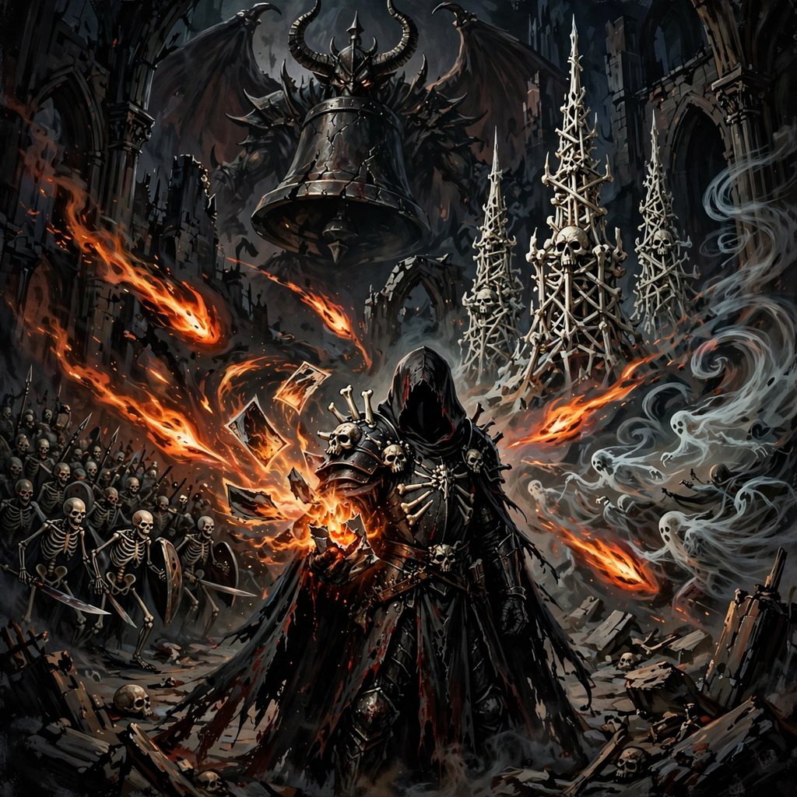

# GRIMPACK



**Crack the seal. Raise your towers. Survive the night.**

A dark-gothic arena survival game where your build doesn't come from a skill
tree — it comes from **booster packs**. You are a lone grave-knight holding a
ruined cathedral floor against ten escalating nights of the dead. Between
waves you tear open wax-sealed packs and pull three cards: towers you place,
weapons that change how your crossbow auto-fires, relics that bend the rules,
and consumables that keep you alive. Bad pulls happen. The night does not care.

▶ **Play it in the browser:** https://mikkel.github.io/grimpack/
(or run it locally — see below)

## How to play

- **Move:** WASD or arrow keys. Your crossbow **fires on its own** at the
  nearest horror — your job is positioning, collecting ashes, and building.
- **Clear a wave** → a fresh pack drops (free). Kills scatter **ashes**;
  walk over them to collect, and spend them on extra packs (price creeps up).
- **Packs** hold 3 cards in five rarities — Common, Magic, Rare, Epic,
  Legendary — and rarity scales the card's numbers. Two dry packs in a row
  and the third is guaranteed a Rare-or-better (pity rule; nobody quits over
  dry packs).
- **Towers** (Bone Spire, Grave Bell, Soul Pyre, Frost Obelisk) go to your
  hand: click the chip, click the arena to place. Pull a duplicate of a tower
  already standing and it **levels up** instead. Max six towers on the field.
- **Weapons & relics** apply instantly and stack forever: more projectiles,
  piercing bolts, crits, regen, a death-blocking ward…
- **Consumables** fire the moment they're pulled: heal, a wrath draught for
  the next wave, or a Saint's Candle that cheats death once.
- **Night 5:** The Abbot tolls. **Night 10:** Vesper, Mother of Bells.
  Clear the tenth night to win. **P** pauses, **M** mutes, **Esc** cancels
  placement.

## Run it locally

Zero build step, zero dependencies — it's three files and a folder of art:

```bash
git clone https://github.com/mikkel/grimpack.git
cd grimpack
python3 -m http.server 8000   # then open http://localhost:8000
```

(Opening `index.html` straight from disk also works in most browsers.)

## What's inside

| File | What it is |
|---|---|
| `index.html` / `style.css` | Page, HUD, pack-opening ceremony, card flips |
| `game.js` | The game: waves, combat, towers, packs, WebAudio synth SFX |
| `balance.js` | **All** tuning numbers — shared by the game and the simulator |
| `tools/sim.js` | Monte-Carlo balance simulator (`node tools/sim.js`) |
| `tools/build_graphs.py`, `tools/build_graph_c.py` | The Nanoodle graphs that generated the art |
| `graphs/` | The actual `.noodle-graph.json` workflows |
| `assets/` | Generated art + `ASSETS.md` manifest |
| `DESIGN.md` / `DEVLOG.md` | Design doc and the iteration rounds |

## Made with Nanoodle

Every image in `assets/` — the knight, the horrors, the towers, the pack, the
card icons, the arena, the key art — was generated through
[Nanoodle](https://nanoodle.com) workflow graphs calling NanoGPT's
`meta/muse-image/text-to-image`, for a **total of $0.286 of a $5 budget**
(26 generations, all usable, no re-rolls). Full manifest with per-asset
costs: [`assets/ASSETS.md`](assets/ASSETS.md). Sound is synthesized live
with WebAudio — no audio files, no spend.

## Balance

Tuned over several rounds against a Monte-Carlo simulator that plays the
pack economy thousands of times (opening packs, applying cards, comparing
expected DPS against each wave's HP budget). The design intent: early nights
are a power fantasy, Night 5's Abbot is the first real check, and the final
night is the tightest fight — winnable on median luck, losable on bad luck
without the pity rule and the ash economy. Details in `DEVLOG.md`.

## License

MIT — see `LICENSE`. Art was AI-generated for this project; use it with the code.

## v2 — the IMPACT pass
The arena fights back: pillars block bolts, the ritual circle consecrates
towers placed inside it, braziers burn, blood stays. Every night rolls an
**Omen** you can plan around. Cards **synergize** (six hidden marriages of
gear). Packs can be traded into, streak into FOIL packs, and towers
overcharged. The dead scheme back: charging brutes, lunging wraiths,
exploding plague bearers, encirclement spawns — and every 20 seconds,
**the night deepens**. Two difficulties: Vigil and Torment.
